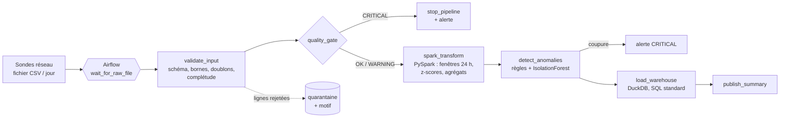

# 📡 NetPulse – Pipeline de qualité de service réseau (Airflow, PySpark, ML)

> Pipeline de données quotidien qui collecte les indicateurs de qualité de service de cellules radio 4G/5G (latence, gigue, perte de paquets, débit, disponibilité), **valide les données et alerte** en cas d'anomalie de collecte, calcule des indicateurs glissants avec **PySpark**, **détecte les incidents réseau par machine learning** et charge le tout dans un entrepôt analytique. L'ensemble est orchestré par **Apache Airflow**.


*Projet personnel. Les données sont **entièrement synthétiques** : un générateur simule 40 cellules dans 4 régions, injecte des incidents réseau connus (pour mesurer la détection) et des défauts de collecte réalistes (pour éprouver la validation). Aucune donnée d'opérateur n'est utilisée.*

## 🏗️ Architecture



| Étape | Ce qui est fait |
|---|---|
| **Attente du fichier** | Capteur Airflow en mode `reschedule` (le worker est libéré entre deux vérifications), délai maximal de 4 h |
| **Validation** | Schéma ; valeurs manquantes ; bornes physiques (perte ≤ 100 %, débit ≥ 0…) ; cellule connue du référentiel ; horodatage dans le jour traité ; doublons ; complétude (mesures reçues / 40 cellules × 24 h). Les lignes rejetées partent en **quarantaine avec leur motif** |
| **Barrière qualité** | `OK` / `WARNING` / `CRITICAL` selon des seuils configurables. Un lot `CRITICAL` est **bloqué** : rien n'est transformé ni chargé, une alerte est envoyée |
| **Transformations PySpark** | Le jour est lu avec ses 3 jours d'historique. Fenêtres glissantes par cellule sur les 24 mesures précédentes (`Window.partitionBy(...).rowsBetween(-24, -1)`) : moyenne et écart-type de la latence et du débit, puis **z-scores**. Agrégats journaliers par cellule (dont la latence p95 avec `percentile_approx`) |
| **Détection d'anomalies** | Règles métier (seuils) et **IsolationForest** (scikit-learn), évalués sur la vérité terrain des incidents injectés |
| **Chargement** | Entrepôt **DuckDB**, idempotent par jour (une réexécution ne crée pas de doublons). Tables et vues en **SQL standard**, portables vers un entrepôt cloud de type BigQuery |
| **Alertes** | Journal JSON Lines, logs, et **webhook** optionnel (Slack, Teams…) via `NETPULSE_WEBHOOK_URL`. Toute tâche en échec déclenche aussi une alerte (`on_failure_callback`) |

## 📊 Résultats mesurés

Exécution sur 14 jours (13 440 mesures attendues), dont **un jour volontairement corrompu** (12 % de débits manquants, export défectueux simulé) :

- **Le jour corrompu est bloqué** par la barrière qualité, avec une alerte `CRITICAL`. Les 13 autres jours sont traités.
- **Validation** : environ 23 lignes rejetées par jour (2,4 %), toutes avec leur motif, et 5 doublons supprimés.
- **Détection des incidents** (10 jours évalués, 142 heures d'incident injectées) :

| Approche | Précision | Rappel | Alertes |
|---|---|---|---|
| Règles (seuils) | 0,864 | 0,894 | 147 |
| IsolationForest seul | 0,747 | 1,000 | 190 |
| **Décision finale : règles ET modèle, ou coupure franche** | **0,934** | **0,894** | **136** |

Le modèle seul retrouve tous les incidents mais produit beaucoup de fausses alertes. Exiger l'accord des deux approches réduit les fausses alertes d'environ moitié par rapport aux règles seules, sans perdre de rappel. Les coupures franches (disponibilité < 50 %) sont toujours signalées en `CRITICAL`.

> Ces chiffres sont obtenus sur des données synthétiques dont les incidents sont connus. Sur des données réelles, les performances seraient à réévaluer, et il faudrait calibrer les seuils avec les équipes réseau.

## 🚀 Lancer le projet

### Avec Docker (Airflow complet)

```bash
git clone https://github.com/mohammed-mrabet/netpulse.git
cd netpulse
docker compose run --rm airflow python -m netpulse.generate --start 2026-10-01 --days 14 --corrupt-day 2026-10-09
docker compose up --build
```

Interface Airflow : http://localhost:8080 (admin / admin). Activer le DAG `netpulse_daily`, puis rejouer la période :

```bash
docker compose exec airflow airflow dags backfill netpulse_daily -s 2026-10-01 -e 2026-10-14
```

### Sans Airflow (développement)

Il faut Python 3.12 et Java 17 (pour Spark).

```bash
pip install -r requirements.txt
python -m netpulse.generate --start 2026-10-01 --days 14 --corrupt-day 2026-10-09
python -m netpulse.pipeline 2026-10-01 2026-10-14
```

Les résultats sont dans `data/` (dans le volume Docker `netpulse-data` en mode Docker) : rapports qualité et anomalies (`reports/`), lignes rejetées (`quarantine/`), alertes (`alerts/alerts.jsonl`) et entrepôt `warehouse/netpulse.duckdb`, avec les vues `v_region_daily` et `v_top_cells_anomalies`.

## 🧪 Tests

```bash
pytest -q
```

**17 tests** :
- **8 tests de validation** : défauts injectés en quarantaine, conservation des lignes, doublons, lot corrompu bloqué, colonne manquante, complétude, horodatage hors du jour, valeur non numérique.
- **6 tests de bout en bout avec Spark** : pipeline sur plusieurs jours, réexécution idempotente, blocage et alerte sur un jour corrompu, fenêtres glissantes calculées uniquement sur les heures précédentes (vérifié contre un calcul pandas), détection des incidents (précision et rappel ≥ 0,6), coupure toujours critique.
- **3 tests d'intégrité du DAG Airflow** : import sans erreur, tâches et dépendances, réglages opérationnels.

La **CI GitHub Actions** lance les tests, exécute le pipeline complet sur 14 jours en vérifiant que le jour corrompu est bloqué, puis installe Airflow 2.10 pour tester le DAG.

## 🛠️ Stack technique

Python 3.12, **Apache Airflow 2.10** (TaskFlow API, branchement, capteur, reprises), **PySpark 3.5** (fonctions de fenêtre, agrégats, Parquet), **pandas**, **scikit-learn** (IsolationForest), **DuckDB** (SQL), Parquet, Docker Compose, pytest, GitHub Actions.

## 🗺️ Pistes d'amélioration

- Déploiement cloud : stockage objet, entrepôt BigQuery, exécution Spark managée
- Suivi des modèles et de la dérive des données (MLflow)
- Contrats de données déclaratifs (Great Expectations ou Pandera)
- Tableau de bord de suivi pour les équipes réseau

## 👤 Auteur

**Mohammed MRABET** – Master Ingénierie Informatique, Faculté des Sciences d'Oujda
[LinkedIn](https://www.linkedin.com/in/mohammed-mrabet-b3021b410/) · [GitHub](https://github.com/mohammed-mrabet)
